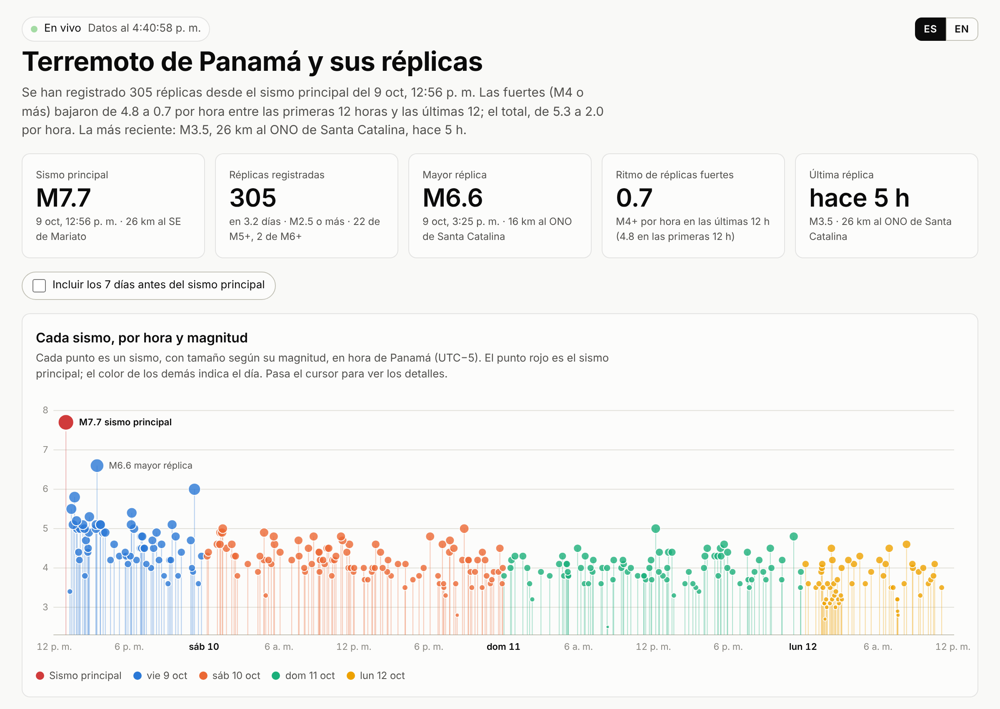

# Sismo Alerta

[English](README.md) · **Español**

**En vivo:** https://sismo-alerta-235ca.web.app · Hecho con [Claude](https://claude.ai): empezó como un Claude Dashboard y Claude escribió el código, las pruebas y la configuración de despliegue.



Notificaciones de sismos para Panamá y la región, con la **intensidad estimada en tu ubicación**, un mapa de los sismos recientes y una **simulación de las ondas P y S** viajando desde el epicentro.

> **Importante:** esto **no es una alerta temprana**. Las agencias publican cada sismo minutos después de que ocurre. Para un sismo cercano, la sacudida llega antes que el aviso. Sirve para saber al instante qué fue, de qué tamaño y cómo te afectó, y para seguir las réplicas. Ante un sismo fuerte, sigue las indicaciones de SINAPROC.

```
EMSC (IGC, UNA, EMSC…)  ──WebSocket──┐
EMSC FDSN (cada 30 s)  ──────────────┼──► Cloud Run "sismo-ingestor" ──► Firestore  events/{id}
USGS (cada 30 s)  ───────────────────┘        │  agrupa orígenes del mismo sismo
                                              │  calcula la intensidad en cada teléfono
                                              └─► FCM ──► app Flutter (notificación)
app Flutter ──► Firestore devices/{uid}: token, ubicación (~1 km), umbral, ajuste local
```

## Qué hay en el repo

| Carpeta | Qué es |
|---|---|
| `backend/` | Servicio Python (aiohttp) para Cloud Run. Escucha el WebSocket del EMSC y además consulta EMSC y USGS cada 30 s como respaldo. Une las soluciones de distintas agencias en un solo evento, lo guarda en Firestore y manda la notificación a cada teléfono cuya intensidad estimada supere su umbral. |
| `app/` | App Flutter (Android e iOS). Incluye el mapa de sismos recientes coloreados por la intensidad que tendrían donde estás, el detalle con la animación de las ondas P y S y las zonas de intensidad que deja la onda S, y los ajustes de umbral, ubicación y ajuste local. |
| `web/` | Página web pública en vivo: mapa de epicentros con reproducción, gráficas, intensidad estimada en un lugar de referencia y tabla. Lee el EMSC directamente desde el navegador de cada visitante, sin servidor. |
| `infra/` | Reglas de Firestore y `deploy.sh` para Cloud Run. |
| `.github/workflows/ci.yml` | Pruebas del backend y, para la app, análisis, pruebas y compilación Android en cada push. |

## Cómo se estima la intensidad

Se usa la ecuación de Atkinson, Worden y Wald (2014), con la magnitud y la distancia hipocentral, más un **ajuste local** configurable en la app.

Con el sismo M7.7 del 9 de octubre de 2026, el modelo coincide con lo que reportó la gente al USGS ("Did You Feel It?") en Chitré (6.5) y en Santiago (6.2). En Ciudad de Panamá, en cambio, el modelo da 4.6 contra 5.1 reportado (169 reportes). Por eso el ajuste local viene en **+0.6** por defecto. La misma fórmula está en `backend/app/intensity.py` y en `app/lib/core/intensity.dart`, y ambas tienen pruebas con esos datos.

Las ondas se animan con velocidades medias de la corteza: P a 6.0 km/s y S a 3.5 km/s.

## Puesta en marcha

### 1. Firebase y Google Cloud
1. **Proyecto:** crea un proyecto en Firebase (o usa uno de Google Cloud y agrégale Firebase).
2. **Firestore:** créalo en modo nativo, en la región que prefieras (por ejemplo `us-east1`).
3. **Autenticación:** en *Authentication → Sign-in method*, activa **Anónimo**.
4. **Notificaciones en iPhone:** sube tu clave APNs en *Project settings → Cloud Messaging*.

### 2. Backend
```bash
PROJECT_ID=tu-proyecto REGION=us-east1 ./infra/deploy.sh
gcloud run services logs read sismo-ingestor --project tu-proyecto --region us-east1 --limit 50
```
Para probarlo en local sin tocar nada, usa `cd backend && DRY_RUN=true python -m app.main` y abre `localhost:8080/status`.

**Costo:** el servicio necesita una instancia siempre encendida (1 vCPU, 512 MiB) para mantener abierto el WebSocket. Con los precios de Cloud Run son unos **US$40–45 al mes**, ya descontado el nivel gratuito; confírmalo en la calculadora de Google Cloud.

Si quieres pagar menos:
- **Consultar cada 30 s sin WebSocket:** pon `POLL_SECONDS=30` y quita el WebSocket. Cloud Run sigue necesitando una instancia activa.
- **Una VM `e2-micro`:** corre el mismo contenedor y entra en el nivel gratuito de Compute Engine en algunas regiones de EE. UU.

### 3. App
Necesitas Flutter estable, Xcode para iOS y Android Studio para Android.
```bash
cd app
python3 tool/setup_platforms.py      # crea android/ e ios/ y agrega permisos y configuración
dart pub global activate flutterfire_cli
flutterfire configure --project=tu-proyecto   # reemplaza lib/firebase_options.dart
flutter run
```
En iOS, abre `ios/Runner.xcworkspace` y agrega las capacidades *Push Notifications* y *Background Modes → Remote notifications*.

## Página web en vivo (`web/`)

Es un sitio estático, sin paso de compilación, en `index.html`, `js/` y `css/`, con d3 y Leaflet incluidos en `vendor/`. Funciona así:
- **Al abrir:** pide al EMSC el catálogo desde el sismo principal, en páginas de 300 eventos.
- **En vivo:** se conecta al WebSocket del EMSC y agrega cada sismo nuevo segundos después de que se publica.
- **Respaldo:** consulta el catálogo cada 2 minutos por si se cae la conexión.

Además lee del USGS los reportes "Did You Feel It?" y el pronóstico oficial de réplicas del sismo principal (`SEQUENCE.usgsEventId`), y permite descargar la tabla en CSV con un enlace a la ficha de cada sismo en el EMSC. Los colores siguen una paleta validada para daltonismo, con pasos propios para modo claro y oscuro: un color por día de la secuencia, rojo para el sismo principal, gris para la semana anterior y la escala de colores de intensidad del USGS (ShakeMap).

Los filtros sobre el mapa eligen el periodo (semana previa, todo, hoy, últimas 24 h, últimas 6 h) la magnitud mínima (M3+, M4+, M5+) y el área: la zona de réplicas inicial, toda la región o lo que muestra el mapa (útil porque la secuencia se va moviendo). El área decide qué sismos cuentan en toda la página, cifras incluidas. El periodo y la magnitud se aplican al mapa, la línea de tiempo, la gráfica de intensidad, la tabla y el CSV; las cifras de arriba y las gráficas de ritmo siempre cuentan toda la secuencia. Los filtros quedan en la dirección, así que un link como `?periodo=24h&mag=4&area=region` abre esa vista.

La gráfica de frecuencia muestra, hora a hora, los sismos por hora de las 6 horas anteriores (todos y M4+, en escala logarítmica), y debajo, en paneles alineados, su magnitud promedio y la intensidad estimada promedio en el lugar de referencia.

**Sismos falsos.** A veces una agencia publica una solución automática de un sismo que no ocurrió. Agrega su id de EMSC en `web/data/excluded.json`, con el motivo en español e inglés, y publica: la página lo saca de todas las cifras, gráficas, el mapa y la tabla, y lo lista en el pie. Las páginas ya abiertas toman el cambio en menos de 5 minutos. Los eventos que el propio EMSC borra o reclasifica desaparecen solos: en vivo, o en la siguiente recarga completa del catálogo (cada 30 minutos).

Para seguir otro sismo, cambia `SEQUENCE` en `web/js/config.js`.

La página está en español e inglés. Toma el idioma del navegador, y el botón ES/EN de arriba lo cambia y lo recuerda. Para compartir un enlace en un idioma, agrega `?lang=en` o `?lang=es`. Todos los textos están en `web/js/i18n.js`.

**Probar en local**
```bash
cd web
npm run serve            # http://localhost:8080
npm install && npm test && npm run e2e   # pruebas; la e2e usa datos fijos del 9 de octubre
```

**Publicar en Firebase Hosting (una vez)**
```bash
npm install -g firebase-tools
firebase login
firebase deploy --only hosting --project tu-proyecto    # desde la raíz del repo
```
Queda en `https://tu-proyecto.web.app`.

**Despliegue automático (opcional).** Cada push a `main` que toque `web/` se publica solo con dos ajustes del repositorio en GitHub:
- **Variable `FIREBASE_PROJECT_ID`:** con el id de tu proyecto.
- **Secreto `FIREBASE_SERVICE_ACCOUNT`:** con la clave JSON de una cuenta de servicio con el rol *Firebase Hosting Admin*.

**Costos.** Una primera visita descarga unos 120 KB comprimidos (d3 va recortado a los módulos que usa la página: `web/tools/build-d3.sh`); las siguientes solo revalidan los archivos propios, unos pocos KB.
- **Plan gratuito (Spark):** el límite es de 360 MB al día, unas 3,000 primeras visitas diarias. Se revisa en la consola de Firebase, en *Hosting → Uso*. Si se pasa del límite, **el sitio deja de servirse hasta el día siguiente**.
- **Plan Blaze:** el exceso cuesta US$0.15/GB, unos 2 centavos por cada 1,000 visitas. Si vas a compartir el link en público, usa Blaze con una alerta de presupuesto (el backend de la app también lo necesita).

**Estadísticas de visitas (opcional).** Pega el ID de medición de Google Analytics 4 (`G-…`) en `ANALYTICS.measurementId` de `web/js/config.js`. Las funciones de publicidad van apagadas, el pie de página lo avisa, y se registra qué filtros, idioma y lugar de referencia usa la gente. Sin ID no se carga nada.

**Límites**
- **Carga sobre el EMSC.** Cada visitante consulta al EMSC directamente, lo que va bien para cientos de personas. Si el link se vuelve viral, conviene que la página lea de un archivo que actualice el backend de la app, para no multiplicar las consultas.
- **Mapas.** Sin configurar nada, el mapa usa los tiles de OpenStreetMap, que sirven para uso ligero. Para compartirlo en público, pide una clave gratuita de CARTO en https://carto.com/basemaps/apikey (uso no comercial: 5 millones de tiles al mes) y pégala en `TILES.cartoKey` de `web/js/config.js`.

## Variables del backend

| Variable | Por defecto | Para qué |
|---|---|---|
| `WATCH_MIN_LAT`, `WATCH_MAX_LAT`, `WATCH_MIN_LON`, `WATCH_MAX_LON` | 2…13 N, 87…73 O | Zona vigilada |
| `MIN_MAG_STORE` | 2.5 | Magnitud mínima que se guarda |
| `POLL_SECONDS` | 30 | Cada cuánto se consultan EMSC y USGS |
| `MAX_NOTIFY_AGE_S` | 1200 | No notificar sismos con más de 20 min de antigüedad |
| `RENOTIFY_DELTA` | 1.0 | Mandar una actualización si la intensidad estimada sube al menos esto |
| `DRY_RUN` | false | No escribe ni envía nada (para pruebas) |

## Limitaciones conocidas
- **Retraso de minutos.** El IGC y el EMSC publican de 3 a 10 minutos después del sismo. Un aviso que llegue antes de la sacudida requiere sensores propios o un sistema oficial.
- **Ubicación con la app abierta.** La ubicación por GPS se actualiza al abrir la app y mientras está abierta. Para recibir alertas con la app cerrada, fija una ubicación (casa u oficina) en Ajustes.
- **El modelo es un promedio.** La intensidad real varía en uno o más grados según el suelo, el edificio y el piso.
- **Mapas de OpenStreetMap.** Usa los tiles públicos, que sirven para uso personal. Si la app crece, conviene un proveedor de tiles propio.

## Licencia

[MIT](LICENSE) © 2026 Noel Moreno Lemus
