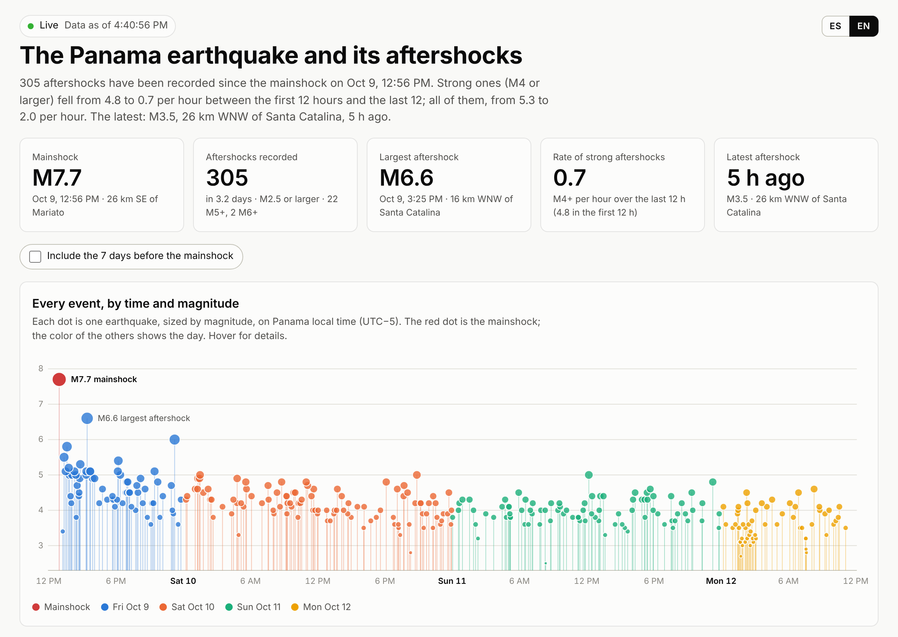

# Sismo Alerta

**English** · [Español](README.es.md)

**Live:** https://sismo-alerta-235ca.web.app/?lang=en · Built with [Claude](https://claude.ai): it started as a Claude Dashboard, and Claude wrote the code, the tests and the deployment setup.



Earthquake tracking and alerts for Panama and the region, with the **estimated intensity where you are**, a map of recent earthquakes and a **simulation of the P and S waves** traveling from the epicenter. It started with the M7.7 earthquake of October 9, 2026 and its aftershocks.

> **Important:** this is **not an early warning**. Agencies publish each earthquake minutes after it happens; for a nearby quake, the shaking arrives before the notice. It's for knowing right away what it was, how big, how it affected you, and for following the aftershocks. In a strong earthquake, follow the instructions of SINAPROC, Panama's civil protection agency.

```
EMSC (IGC, UNA, EMSC…)  ──WebSocket──┐
EMSC FDSN (every 30 s)  ─────────────┼──► Cloud Run "sismo-ingestor" ──► Firestore  events/{id}
USGS (every 30 s)  ──────────────────┘        │  merges solutions of the same quake
                                              │  estimates the intensity at each phone
                                              └─► FCM ──► Flutter app (notification)
Flutter app ──► Firestore devices/{uid}: token, location (~1 km), threshold, local adjustment
```

## What's in the repo

| Folder | What it is |
|---|---|
| `web/` | The public live page: map of epicenters with playback, charts, estimated intensity at a reference place, the official USGS aftershock forecast and a table. Spanish and English. It reads EMSC straight from each visitor's browser, with no server. |
| `backend/` | Python service (aiohttp) for Cloud Run. It listens to the EMSC WebSocket and also polls EMSC and USGS every 30 s as a fallback. It merges the solutions from different agencies into one event, stores it in Firestore and notifies every phone whose estimated intensity is above its threshold. |
| `app/` | Flutter app (Android and iOS): a map of recent earthquakes colored by the intensity they'd have where you are, a detail view with the P and S wave animation and the intensity zones the S wave leaves behind, and settings for threshold, location and local adjustment. |
| `infra/` | Firestore rules and `deploy.sh` for Cloud Run. |
| `.github/workflows/` | CI on every push (backend tests; web unit and browser tests; app analysis, tests and Android build) and the optional web deploy. |

## How intensity is estimated

The page and the app use the Atkinson, Worden & Wald (2014) intensity prediction equation, with magnitude and hypocentral distance, plus a configurable **local adjustment**.

For the M7.7 earthquake of October 9, 2026, the model matches what people reported to USGS "Did You Feel It?" in Chitré (6.5) and Santiago (6.2). In Panama City, though, the model gives 4.6 against 5.1 reported (169 reports), so the local adjustment defaults to **+0.6** there. The same formula lives in `backend/app/intensity.py`, `app/lib/core/intensity.dart` and `web/js/intensity.js`, each tested against those data.

Waves are animated with average crustal speeds: P at 6.0 km/s and S at 3.5 km/s.

## Live page (`web/`)

A static site with no build step (`index.html`, `js/`, `css/`, with d3 and Leaflet vendored in `vendor/`):
- **On load:** it asks EMSC for the catalog since the mainshock, in pages of 300 events.
- **Live:** it connects to the EMSC WebSocket and adds each new earthquake seconds after it's published.
- **Fallback:** it polls the catalog every 2 minutes in case the connection drops.

It also reads the USGS "Did You Feel It?" reports and official aftershock forecast for the mainshock (`SEQUENCE.usgsEventId`), and lets you download the table as CSV, with a link to each earthquake's EMSC page. Colors follow a palette checked for color blindness, with separate steps for light and dark mode: one color per day of the sequence, red for the mainshock, gray for the week before, and the USGS ShakeMap intensity scale.

Filters above the map choose the period (week before, all, today, last 24 h, last 6 h) the minimum magnitude (M3+, M4+, M5+) and the area: the original aftershock zone, the whole region, or whatever the map shows (useful as the sequence moves). The area decides which earthquakes count everywhere on the page, figures included. Period and magnitude apply to the map, the timeline, the intensity chart, the table and the CSV; the figures at the top and the rate charts always count the whole sequence. Filters go in the address too, so a link like `?periodo=24h&mag=4&area=region` opens that view.

The frequency chart shows, every hour, the earthquakes per hour over the previous 6 hours (all and M4+, on a log scale), with their mean magnitude and mean estimated intensity at the reference place in aligned panels below.

**Confirmed earthquakes only.** The page asks EMSC for every agency's solution of each earthquake (QuakeML with `includeallorigins`), not just the one EMSC prefers. An earthquake counts when the national network (IGC, set in `EMSC.trustedAuthors`) located it, when two or more agencies did, or when an analyst reviewed a solution. A single automatic solution from another agency, like the false M4.0 near Panama City on October 13, 2026, stays *unconfirmed*: it is drawn hollow on the map and listed under it, but it isn't counted and raises no notice. It starts counting on its own if another agency confirms it.

**False events.** Agencies sometimes publish an automatic solution for an earthquake that didn't happen. List its EMSC id in `web/data/excluded.json`, with the reason in Spanish and English, and deploy: the page leaves it out of every count, chart, map and table and lists it in the footer. Pages already open pick the change up within 5 minutes. Events that EMSC itself deletes or reclassifies disappear on their own: live, or at the next full reload of the catalog (every 30 minutes).

To follow a different earthquake, change `SEQUENCE` in `web/js/config.js`.

The page is in Spanish and English. It follows the browser's language, and the ES/EN button at the top switches and remembers it. To share a link in one language, add `?lang=en` or `?lang=es`. All text lives in `web/js/i18n.js`.

**Run locally**
```bash
cd web
npm run serve            # http://localhost:8080
npm install && npm test && npm run e2e   # tests; e2e uses fixed data from October 9
```

**Publish to Firebase Hosting (once)**
```bash
npm install -g firebase-tools
firebase login
firebase deploy --only hosting --project your-project    # from the repo root
```
It goes live at `https://your-project.web.app`.

**Automatic deploy (optional).** Every push to `main` that touches `web/` is published, once two repository settings exist on GitHub:
- **Variable `FIREBASE_PROJECT_ID`:** your project id.
- **Secret `FIREBASE_SERVICE_ACCOUNT`:** the JSON key of a service account with the *Firebase Hosting Admin* role.

**Costs.** A first visit downloads about 120 KB compressed (d3 is trimmed to the modules the page uses: `web/tools/build-d3.sh`); later visits only revalidate the page's own files, a few KB.
- **Free plan (Spark):** 360 MB a day, about 3,000 first visits. Check it in the Firebase console under *Hosting → Usage*. Past the limit, **the site stops being served until the next day**.
- **Blaze plan:** extra transfer costs US$0.15/GB, about 2 cents per 1,000 visits. If you share the link publicly, use Blaze with a budget alert (the app backend needs it too).

**Visit statistics (optional).** Paste the Google Analytics 4 measurement ID (`G-…`) into `ANALYTICS.measurementId` in `web/js/config.js`. Advertising features are off, the footer says so, and the page records which filters, language and reference place people use. Without an ID nothing is loaded.

**Limits**
- **Load on EMSC.** Each visitor queries EMSC directly, which is fine for hundreds of people. If the link goes viral, the page should read from a file the app backend updates instead.
- **Maps.** With no setup the map uses OpenStreetMap's tiles, which are fine for light use. For public use, get a free CARTO key at https://carto.com/basemaps/apikey (non-commercial: 5 million tiles a month) and paste it into `TILES.cartoKey` in `web/js/config.js`.

## IGC monitor and Telegram alerts

The Instituto de Geociencias (IGC) publishes its quakes at https://sismosgeociencias.up.ac.pa/ about 2–3 minutes after they happen, faster than EMSC (3–10 minutes), but only as an HTML table with no API. The monitor (`backend/app/monitor_main.py`) is a small Cloud Run service that Cloud Scheduler wakes once a minute:

- **Checks cheaply:** it asks IGC whether the page changed (ETag), and only reads it when it did.
- **Tracks revisions:** it finds new quakes and IGC's revisions (PRELIMINAR → REVISADO, magnitude changes), keeping each quake's id through them.
- **Alerts on Telegram:** it posts each new quake to a Telegram channel, with the estimated intensity in Panama City and links, and edits that message when IGC revises the quake, also replying to it (silently) with what changed, so the chat shows which message was updated. A new quake within 10 minutes and 40 km of one already announced is sent as a reply to it, saying IGC lists it as a separate quake. By default it covers M3.5 or larger within 400 km of Panama City, arriving silently below M4.0.
- **Has a backup:** when IGC's page is down (maintenance, errors) or stops changing for 15 minutes, it takes IGC's own solutions from EMSC (author IGC only), a few minutes later, and announces those. When IGC's list is back it matches them with IGC's rows and edits the messages instead of repeating them. If IGC stays down for 10 minutes, a silent message in the channel says so, quoting the page, and another says when it's back.
- **Reads IGC's posts on X:** IGC posts every quake on X (@igcpanamaup) with the same text as its WhatsApp notices, minutes before its web list, and kept doing so on October 14, 2026 while its page and its EMSC feed were down. With an X API token (`X_BEARER_TOKEN`, pay-per-use at developer.x.com), every tick reads only the posts newer than the last one, so a quiet minute costs nothing and a busy day a few cents. Posts are announced like the list's quakes, the REVISADO post edits the message, and the button links to IGC's post.
- **Takes IGC's WhatsApp notices:** IGC's WhatsApp notices arrive minutes before its web list, and sometimes they are the only thing IGC publishes (on October 14, 2026 its page and its EMSC feed stopped for hours while WhatsApp kept going). An allowed person (`RELAY_USERS`) forwards or pastes a notice to the bot in a private chat. The bot reads it, works out the location from the town, distance and direction, and posts the same card to the channel within seconds, through the same filters. When IGC's list has the quake, the bot refreshes that message instead of repeating it. Starting a message with `prueba` only shows a preview; `/estado` says whether IGC's list is working.
- **Feeds the page:** it writes a public feed to Cloud Storage that the page reads every minute (`IGC_FEED` in `web/js/config.js`). IGC quakes count as confirmed, show up before EMSC has them, and are merged with EMSC's version once it arrives.

It scales to zero between ticks and stays within the free tiers of Cloud Run, Cloud Scheduler and Cloud Storage (the project must be on the Blaze plan). It identifies itself to IGC in its User-Agent.

**Setup**
1. **Bot:** in Telegram, talk to @BotFather, send `/newbot` and keep the token.
2. **Channel:** create a public channel (for example `@sismos_panama_live`) and add the bot as an administrator that can post messages.
3. **Deploy:** run `PROJECT_ID=your-project TELEGRAM_BOT_TOKEN=... TELEGRAM_CHAT_ID=@sismos_panama_live RELAY_USERS=@your_username ./infra/deploy-monitor.sh`. The service is public so Telegram can reach `/telegram`, and every route checks a key the script creates (`monitor-key` in Secret Manager).
4. **Connect the page:** paste the feed URL the script prints into `IGC_FEED.base` in `web/js/config.js`, and deploy the page.

To check the Telegram side without a real quake, `POST /test` sends a message labelled "🧪 PRUEBA — no es un sismo real" through the same filters and format, edits it as a revision would, and deletes it after 30 seconds (`?keep=0` leaves it). It never touches the state or the feed. The deploy script prints the exact command.

Tune it with `NOTIFY_MIN_MAG`, `LOUD_MIN_MAG` and `NOTIFY_MAX_KM` when running the script. On its first run the monitor only learns what's already listed; it never announces anything older than 30 minutes.

## Setting up the app and backend

### 1. Firebase and Google Cloud
1. **Project:** create a Firebase project (or add Firebase to a Google Cloud one).
2. **Firestore:** create it in native mode, in the region you prefer (for example `us-east1`).
3. **Authentication:** under *Authentication → Sign-in method*, turn on **Anonymous**.
4. **iPhone notifications:** upload your APNs key under *Project settings → Cloud Messaging*.

### 2. Backend
```bash
PROJECT_ID=your-project REGION=us-east1 ./infra/deploy.sh
gcloud run services logs read sismo-ingestor --project your-project --region us-east1 --limit 50
```
To try it locally without touching anything: `cd backend && DRY_RUN=true python -m app.main`, then open `localhost:8080/status`.

**Cost:** the service needs one always-on instance (1 vCPU, 512 MiB) to keep the WebSocket open. At Cloud Run prices that's about **US$40–45 a month** after the free tier; check it in the Google Cloud pricing calculator.

To pay less:
- **Poll every 30 s without the WebSocket:** set `POLL_SECONDS=30` and drop the WebSocket. Cloud Run still needs an active instance.
- **An `e2-micro` VM:** runs the same container and falls within the Compute Engine free tier in some U.S. regions.

### 3. App
You need stable Flutter, Xcode for iOS and Android Studio for Android.
```bash
cd app
python3 tool/setup_platforms.py      # creates android/ and ios/ with permissions and settings
dart pub global activate flutterfire_cli
flutterfire configure --project=your-project   # replaces lib/firebase_options.dart
flutter run
```
On iOS, open `ios/Runner.xcworkspace` and add the *Push Notifications* and *Background Modes → Remote notifications* capabilities.

## Backend settings

| Variable | Default | What for |
|---|---|---|
| `WATCH_MIN_LAT`, `WATCH_MAX_LAT`, `WATCH_MIN_LON`, `WATCH_MAX_LON` | 2…13 N, 87…73 W | Area watched |
| `MIN_MAG_STORE` | 2.5 | Smallest magnitude stored |
| `POLL_SECONDS` | 30 | How often EMSC and USGS are polled |
| `MAX_NOTIFY_AGE_S` | 1200 | Don't notify quakes older than 20 min |
| `RENOTIFY_DELTA` | 1.0 | Send an update if the estimated intensity rises at least this much |
| `DRY_RUN` | false | Writes and sends nothing (for testing) |

## Known limitations
- **Minutes of delay.** IGC and EMSC publish 3 to 10 minutes after the quake. A warning that arrives before the shaking needs dedicated sensors or an official system.
- **Location while the app is open.** GPS location updates when the app opens and while it's open. To get alerts with the app closed, set a fixed location (home or office) in Settings.
- **The model is an average.** Real intensity varies by one degree or more with the ground, the building and the floor.
- **OpenStreetMap tiles.** The app uses the public tiles, which are fine for personal use. If it grows, it should move to its own tile provider.

## Data sources

- Earthquakes: [EMSC Seismic Portal](https://www.seismicportal.eu), which brings together the Institute of Geosciences of the University of Panama (IGC), the National University of Costa Rica (UNA), USGS (NEIC) and EMSC.
- "Did You Feel It?" reports and the aftershock forecast: [USGS](https://earthquake.usgs.gov/earthquakes/eventpage/us6000u18k).
- Map: © [OpenStreetMap](https://www.openstreetmap.org/copyright) contributors.

## License

[MIT](LICENSE) © 2026 Noel Moreno Lemus
